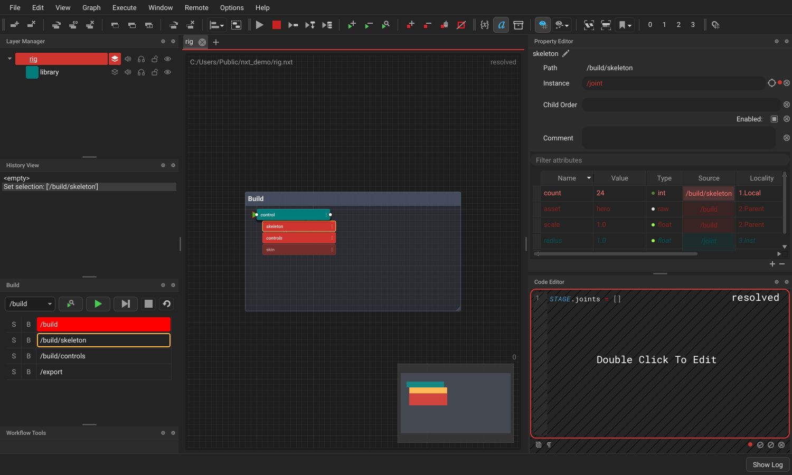

<div align="center">

[](https://github.com/nxt-dev/nxt_editor/actions/workflows/release.yml)
[](https://github.com/nxt-dev/nxt_editor/actions/workflows/unittests.yml?query=branch%3Adev)

[](https://github.com/nxt-dev/nxt_editor/releases/latest)
[](LICENSE)&nbsp;&nbsp;


# NXT Editor

</div>

**nxt** (**/ɛn·ɛks·ti/**, node execution tree) is a layered, composable
Python node graph for pipelines: rigging, scene assembly, builds and other
automation. A graph is Python code split into nodes. Nodes inherit
attributes from their parents, attributes are substituted into the code as
tokens, and graphs are stacked as layers that override each other, so a
shared build can be changed per asset or per shot without copying it.

nxt comes in two parts:

- **nxt_editor** (this repository): the visual editor, a Qt application
  that runs standalone or inside Maya, Blender and Unreal.
- **[nxt core](https://github.com/nxt-dev/nxt)** (`nxt-core` on PyPI):
  the graph engine. It loads, composites and runs graphs with no UI, so
  the same graph runs on a farm, in a CI job or inside a host.

[Docs](https://nxt-dev.github.io/) |
[What's New](docs/user_docs/docs/whats_new.md) |
[Install](#install) |
[Contributing](CONTRIBUTING.md) |
[License](LICENSE)



## Features

- **Layers and composition.** A graph is a stack of layers. Each layer can
  add nodes or override attributes and code from the layers below it, and
  layers can be muted, soloed, locked or hidden in the graph. See
  [Layers](docs/user_docs/docs/reference.md#layers).
- **Inheritance, tokens and instancing.** Child nodes inherit their
  parent's attributes, `${tokens}` resolve attribute values into code, and
  a node can instance another to reuse it with its own overrides. See
  [Instancing](docs/user_docs/docs/reference.md#instancing) and
  [Tokens](docs/user_docs/docs/reference.md#tokens).
- **Sub-graphs.** A node can run another graph and get values back from
  it. **Open Sub-graph** opens that graph. See
  [Sub-graph nodes](docs/user_docs/docs/reference.md#sub-graph-nodes).
- **Outliner and Instance View.** The Outliner lists nodes as a tree
  grouped by the build that runs them, with search and drag to parent. The
  Instance View shows only a node's instance connections. See
  [Outliner](docs/user_docs/docs/reference.md#outliner) and
  [Instance View](docs/user_docs/docs/reference.md#instance-view).
- **Backdrops, bookmarks and layout tools.** Colored boxes behind groups
  of nodes, saved views, align and distribute, and automatic layout by run
  order. See [Backdrops](docs/user_docs/docs/reference.md#backdrops).
- **Code editor with completion.** Find and replace, folding, token hover
  and Ctrl+click to follow, and completion of node attributes, tokens and
  imported modules (richer with the optional jedi). See
  [Code Editor](docs/user_docs/docs/reference.md#code-editor).
- **AI Assistant.** An optional panel to chat with a model about the open
  graph. It can search, explain, change and run the graph, and all its
  changes in one reply undo together. Nothing is sent until you ask. See
  [AI Assistant](docs/user_docs/docs/reference.md#ai-assistant).
- **Preferences.** Every setting in Edit > Preferences, a section at a
  time: preferences, hotkeys, the AI Assistant, environment variables and
  optional components, with a search across all of them. See
  [Preferences](docs/user_docs/docs/reference.md#preferences).
- **Looks.** Modern (the default), Classic, or Host application, which
  takes on the look of Maya, Blender or Unreal when the editor runs in
  them. See [The editor's look](docs/user_docs/docs/reference.md#the-editors-look).
- **Headless runs.** Graphs run without the editor from the command line,
  from Python, or inside a headless Maya. See
  [Running a graph without the editor](#running-a-graph-without-the-editor).
- **Host integrations.** Plugins for Maya 2025 to 2027, Blender 4.2 and
  newer, and Unreal 5.4 to 5.8, each with an nxt menu. See
  [Host applications](docs/user_docs/docs/install.md#host-applications).

The full list, release by release, is in
[What's New](docs/user_docs/docs/whats_new.md).

## Install

Requirements:

- Python [3.11](https://www.python.org/downloads/release/python-3110/) to [3.13](https://www.python.org/downloads/release/python-3130/).
- Qt through [Qt.py](https://github.com/mottosso/Qt.py) (below 3) on
  [PySide6](https://doc.qt.io/qtforpython-6/) (6.x, below 6.12). pip
  installs both.
- Windows, macOS or Linux. The same release runs on every platform and in
  every host. It carries a faster comp engine, compiled in Rust for each
  of them, and works the same without it, see
  [The faster comp engine](docs/user_docs/docs/install.md#the-faster-comp-engine).

We recommend a [virtual environment](https://docs.python.org/3/library/venv.html).

### From PyPI

```
pip install nxt-editor
```

This installs `nxt-core` with it. For richer code completion, add the
optional jedi extra, or install it later from
**Edit > Preferences > Optional Components** in the editor:

```
pip install "nxt-editor[completion]"
```

The PyPI release can be behind this repository. For the newest code,
install from git.

`nxt --version` ends with `Comp native` when graphs are composited by the
faster engine. `NXT_COMP_ENGINE=python` composites with the Python code
instead.

### From git

Install the core from the same branch first, so the editor gets the core it
was developed against:

```
pip install git+https://github.com/nxt-dev/nxt.git@dev
pip install git+https://github.com/nxt-dev/nxt_editor.git@dev
```

With [Rust](https://rustup.rs) installed, the core install builds the
faster comp engine for your machine. Without it, nxt runs on its Python
code, slower on big graphs and otherwise the same.

Use `@release` for the latest release, or a tag name for a specific one.

### Launch

The `nxt` command comes from nxt core:

```
nxt ui
nxt ui path/to/graph.nxt
```

`python -m nxt.cli ui` does the same where the `nxt` script is not on your
`PATH`. `nxt --version` prints the core, editor and graph format versions.

### Host applications

Maya, Blender and Unreal each get a zip on the
[latest release](https://github.com/nxt-dev/nxt_editor/releases/latest)
that carries nxt, nxt_editor and Qt.py, so nothing has to be pip
installed into the host. Install steps for each:

- [Maya](docs/user_docs/docs/install.md#maya) (2025, 2026, 2027)
- [Unreal](docs/user_docs/docs/install.md#unreal) (5.4 to 5.8)
- [Blender](docs/user_docs/docs/install.md#blender) (4.2 and newer)

Blender and Unreal ship no Qt; their nxt menu installs PySide6 once, see
[Qt for Blender and Unreal](docs/user_docs/docs/install.md#qt-for-blender-and-unreal).
Each zip also has a `README.md`, from
[integration/maya](nxt_editor/integration/maya/README.md),
[integration/blender](nxt_editor/integration/blender/README.md) and
[integration/unreal](nxt_editor/integration/unreal/README.md).

## Running a graph without the editor

nxt core runs graphs with no UI. It is all you need on a farm or in a CI
job (`pip install nxt-core`).

From the command line:

```
nxt exec path/to/graph.nxt
nxt exec path/to/graph.nxt -s /start_node
nxt exec path/to/graph.nxt -p /.root_dir /path/to/files
```

`-s` picks the node to start from (without it, the graph's start point is
used) and `-p` sets attribute values before the run, as `/node.attr value`
pairs or the path to a JSON file.

From Python:

```python
import nxt

nxt.execute_graph('path/to/graph.nxt', start='/start_node',
                  parameters={'/.root_dir': '/path/to/files'})
```

Inside a headless Maya, use `run_maya_graph.py` with `mayapy`, see
[Running a graph in Maya standalone](docs/user_docs/docs/install.md#running-a-graph-in-maya-standalone).
In Blender, **NXT > Run Graph...** runs a graph without opening the editor,
including in `--background` sessions.

## Repository layout

| Path | What is there |
| :--- | :------------ |
| `nxt_editor/` | The editor package. `main_window.py` is the window, `stage_view.py` and `node_graphics_item.py` draw the graph, `stage_model.py` wraps the core's stage for the editor, `commands.py` holds the undoable edits. |
| `nxt_editor/dockwidgets/` | The docked panels: Property Editor, Code Editor and completion, Layer Manager, Outliner, Instance View, Build View, Output Log, History View, Reference Editor and the AI Assistant panel. |
| `nxt_editor/ai/` | The AI Assistant: providers, sign in, tools it uses on the graph, chats and memory. |
| `nxt_editor/theme.py` | The editor's colors, fonts and stylesheet. |
| `nxt_editor/resources/` | Icons, fonts and stylesheets, listed in `resources.qrc` and read at runtime by `qt_resources.py`. |
| `nxt_editor/integration/` | The Maya plugin and module, the Blender add-on, the Unreal plugin, and the optional dependency installer shared by them. |
| `nxt_editor/test/` | The pytest suite. |
| `docs/user_docs/` | The user docs, built with MkDocs and published at [nxt-dev.github.io](https://nxt-dev.github.io/). |
| `examples/` | Example graphs that walk through the main concepts. |
| `build/` | nxt graphs and scripts that build the release packages and the host zips. |

## Contributing

Contributions are welcome. See [CONTRIBUTING.md](CONTRIBUTING.md) for
setting up both repositories from source, running the tests, IDE setup and
what a pull request needs. Work goes against the `dev` branch.

## License

nxt is released under the [MIT License](LICENSE).

## Links

- Docs: [nxt-dev.github.io](https://nxt-dev.github.io/)
- Editor: [github.com/nxt-dev/nxt_editor](https://github.com/nxt-dev/nxt_editor)
- Core: [github.com/nxt-dev/nxt](https://github.com/nxt-dev/nxt)
- PyPI: [nxt-editor](https://pypi.org/project/nxt-editor/) and
  [nxt-core](https://pypi.org/project/nxt-core/)

## Special Thanks

[Sunrise Productions](https://sunriseproductions.tv/) | [School of Visual Art and Design](https://www.southern.edu/visualartanddesign/)
