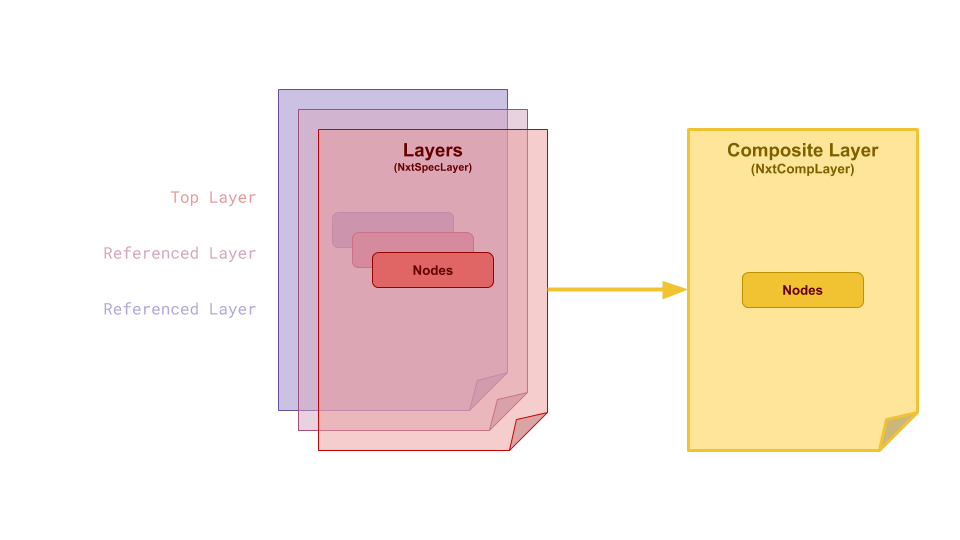
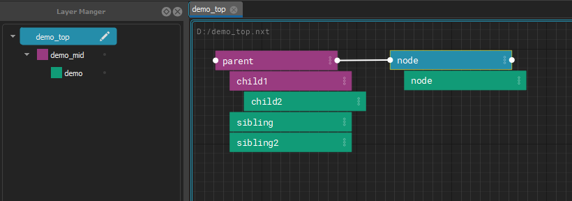
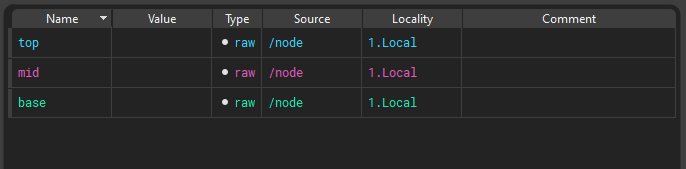
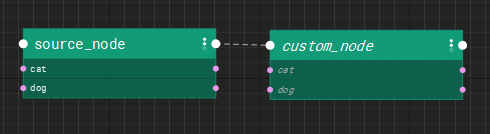
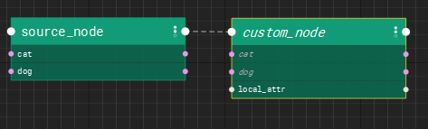
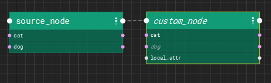
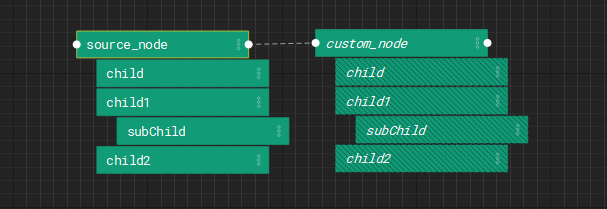
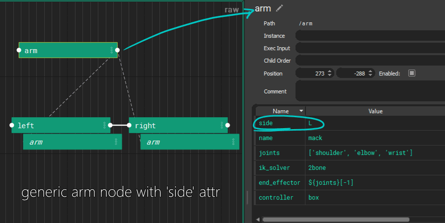

# Layers and References

A graph is composed (combined) from layers. Each layer holds its own
opinions about nodes, and the layers stack, so a stronger layer can change a
node from a weaker one without touching that layer's file. Layers pull other
layers in through references. Inside a layer, nodes also inherit from their
parents and from the nodes they instance.

For editing references in the editor, see the
[Reference Editor](editor.md#reference-editor) and
[Reload Source](editor.md#reload-source).

## Layers

[Stages ](graphs.md#stage)are designed to be combined together to create a hierarchy of instructions that can be reused and repurposed by several NXT users for use on several assets or workflows. When a stage is referenced into another stage, it is a “layer” within that stage.

All of the layers in your file are composited together to produce final code to execute. Each layer has the power to change as much or as little as is needed to customize the composited node’s attributes and code block. These changes are stored in the file they are made on, keeping referenced files safe to use for many purposes.

Layer color propagates into nodes an also attributes.

## References

A layer pulls other layers in through its **references**. They are stored in
the layer's file as a list:

    "references": [
        "base_steps.nxt",
        "$PROJECT_ROOT/lib/shared_steps.nxt"
    ]

References are a stack: the first one in the list is the strongest of them,
directly below the layer that references it, and each one after it is
weaker. A referenced layer can have references of its own.

Edit them with the [Reference Editor](editor.md#reference-editor) (right click a layer
in the Layer Manager > **Edit References...**), or add one with
**Reference Layer Above/Below** and **Reference Builtin Graph** from the
**File** menu. To pick up changes somebody else saved to any of these files,
use [Reload Source](editor.md#reload-source).

### How references are found

A reference is stored exactly as it was written, which is often only part of
a path. Environment variables (`$NAME`) and `~` in it are expanded first.
Then:

1. **An absolute path** is used as it is.
2. **Anything else** is looked for under each folder listed in the
   `NXT_FILE_ROOTS` environment variable, in order. Separate the folders
   with `;` on Windows and `:` on Linux and macOS.
3. If no root has it, it is looked for relative to the folder of the layer
   that holds the reference. That is the layer's own folder, not the folder
   of the top graph and not wherever the editor was started.

The first file found is used. The same order is used when a graph is
opened, when a reference is added in the editor, when a layer is reloaded
with Reload Source, and by the Reference Editor's resolved view, so they
always agree.

For example, with `NXT_FILE_ROOTS=/projects/show_a;/projects/library`, the
reference `lib/shared_steps.nxt` is found at
`/projects/show_a/lib/shared_steps.nxt` if it exists there, otherwise at
`/projects/library/lib/shared_steps.nxt`, and otherwise at
`lib/shared_steps.nxt` in the referring layer's folder. Because what is
stored is the partial path, the same graph keeps working on another
machine, or for another project, with different roots.

!!! note "A root wins over a file beside the layer"
    Because the roots are tried first, a file under a root is used even when
    a file of the same name sits next to the layer. This is deliberate: put
    a folder holding your working copies first in `NXT_FILE_ROOTS`, and a
    graph that references `rig_steps.nxt` picks up your working copy of
    `rig_steps.nxt` instead of the published one beside it, without
    changing the graph. Take the folder out of `NXT_FILE_ROOTS` to go back.
    To always use one particular file, reference it by an absolute path, or
    by a path built from an environment variable.

The [Reference Editor](editor.md#reference-editor) shows where each reference
resolves on this machine with its resolved toggle, and the tooltip on a row
says where nxt looked.

!!! note "References that cannot be found are kept"
    If a referenced file cannot be found, for example because it lives on a
    share this machine cannot see, the graph still opens without that layer,
    and the failure is logged. The reference itself is kept on the layer
    exactly as written, so saving the layer does not remove it. The Reference
    Editor draws such references in red.

## Composition Inside Node Hierarchies

When a [node ](graphs.md#node)is a child of another node, it [inherits ](concepts.md#inheritance)its [attributes ](graphs.md#attributes)from that node which can be overwritten locally on the node.

## Instancing

Instancing allows you to reuse nodes from other parts of the graph with specific overrides. 

Instances in NXT can be simple and powerful. But they can also be extremely complicated with mind-bending edge cases. In simple terms, you can think about an  instance as a clone of another node. It's like a live copy. But it's a bit more nuanced to think about an instance like an additional parent that's outside the hierarchy.

!!! example

    - If you create a node, don't add any attributes or code, it will just look like a clone of the instance source.
    
    
    
    - If you create a node with unique attributes it will look like the instance source is another parent. All the attributes will composite from the instance source, and the local attributes will be visible as well.
    
    
    - If you create a node with attributes named the same as the instance source, the local attributes will have a stronger opinion and overwrite the instance values. In this case, `cat` exists on `custom_node` so it's value wins.
    

The children of the instance node get inserted into the hierarchy as proxy children. This data exists only as a result of the composite. The are not local saved data. Proxy children are drawn in a hashed style to make it clear you haven't touched the data.

As soon as you begin to edit proxy children, the are converted into real editable nodes and exist in the hierarchy

!!! note
    The hierarchy has the final opinion in the composite. _UNLESS_ the node has an local opinion on the data.

    - Layer stage
    - Node parent
    - Node
    - Instance parent
    - Instance

!!! example
    Build a base arm. Instance it twice. Change L to R, done.
    

An instance of a node inherits data like a child. It creates proxy children of the instance source’s children, and can be arranged into a separate parent-child relationship as it’s instance source. 

Most instance attributes are carried over. Execution input is never inherited. Child order is inherited by instances but not by children.

Data comes from the hierarchical parent as well as the instance source, with hierarchical parent  having final word. Instance execution order is defined by the hierarchical parent.

!!! danger
    If a node instances itself, or any ancestor or descendants, it will crash. It's best (because that's all thats possible) to only instance from other hierarchies or sibling nodes
