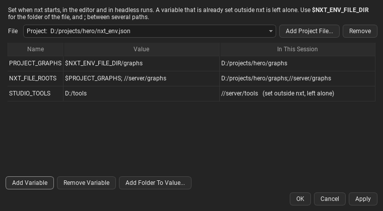

# Extensions

NXT can easily extended to better meet a user's/studio's needs. In this section you will find examples of how to use NXT's configuration and plugin system.

**If you're looking for a quick test and not trying to dive too deep, we have an *almost* drag and drop example Maya context [here](https://github.com/nxt-dev/nxt_editor/tree/release/examples/quick_start_graphs).** 

# Config dir

Custom configurations are graphs and code that extends or alters the functionality of nxt. Cofigs are not to be confused with preferences which are soley UX related.

To add a config there are two approaches, both of which are compatible with eachother.

1. Local config
   
   - Config directory location: `~/nxt/config/<major_api_version>`

2- Site config

- Site config directory can be set via an environment variable. `NXT_SITE_DIR=/path/to/site_config`

Inside the config dir you'll need a directory called `plugins`. So for example if you're using API `v0.1.2` your local config plugins dir would be: `~/nxt/config/0/plugins`

# Env files

Graphs often lean on environment variables: a `$PROJECT_GRAPHS/rig.nxt`
reference, the roots in `NXT_FILE_ROOTS`, whatever the code in a node reads.
An env file sets them when nxt starts, so they do not have to be set by
whatever launches nxt. It works the same in the editor, in a host such as
Maya, and in a headless run.

```json
{
    "version": 1,
    "include": ["D:/projects/hero/nxt_env.json"],
    "variables": {
        "PROJECT_GRAPHS": "$NXT_ENV_FILE_DIR/graphs",
        "NXT_FILE_ROOTS": ["$PROJECT_GRAPHS", "//server/graphs"]
    }
}
```

- A value is text, or a list, which is joined with the platform's path
  separator so one file serves Windows and Linux.
- `$NXT_ENV_FILE_DIR` is the folder of the file it is written in. A file
  written with it can be committed beside the graphs it points at.
- Other variables are filled in as each value is set, so a value can use one
  set above it or in a file read earlier. Write them `$NAME` or `${NAME}`;
  `${NAME}` is the one to use when letters follow the name. A variable that
  is not set is left as written, and logged with the file and the variable
  it is in. On Windows names ignore case, as they do in the environment
  there.
- `include` names other env files, read first, so the including file has the
  last word. A relative path is relative to the file.

nxt reads, in this order, later files winning:

1. `env.json` in the site config dir
2. `env.json` in the local config dir
3. the files listed in the environment variable `NXT_ENV_FILES`

A variable that is already set when nxt starts is left alone, so whatever
launched nxt keeps the last word. `NXT_USER_DIR`, `NXT_SITE_DIR` and
`NXT_ENV_FILES` decide which files are read, so they cannot be set from one:
a file that sets one is logged and that variable is passed over. A file that
is missing or cannot be read is logged and skipped.

Once these variables are set, a file you pick to reference is stored the
short way when it can be: relative to a root in `NXT_FILE_ROOTS`, or from a
variable an env file declares, as `$PROJECT_GRAPHS/rig.nxt`. This applies to
everyone with `NXT_FILE_ROOTS` set, env files or not. See
[How references are found](reference.md#how-references-are-found).



**Options > Environment Variables...** edits these files as a table: your
own file, the site's, any named in `NXT_ENV_FILES`, and project files.
Tick **List** for a value of several paths, typed with `;` between them: it
is saved as a list and joined with the separator of the platform nxt runs
on. A name that holds paths, such as `NXT_FILE_ROOTS` or one ending in
`PATH`, starts out ticked. Any other value is kept exactly as typed, `;` and
all.
**Add Project File...** picks or creates an env file anywhere, typically in
a project's repository, and has your own file include it. **In This
Session** shows what each variable holds now, and says when it was set
outside nxt and so left alone. **Apply** saves and sets the variables in the
running session; graphs opened or reloaded afterwards use them.

From code: `nxt.env_files.apply()` reads the files again.

# Plugins

Any `.py` files inside your plugin dir(s) will automatilly be imported during nxt startup. 

## Creating Custom Contexts

It is possible to execute graphs in "remote contexts", for example it one may want to execute a graph in a headless Maya session. These remote contexts can easilly be configured by users and TDs, this section will provide some examples on how to go about writing your own custom context plugin.

Below is an exmaple of creating a custom Maya context. This code is an example to get you started, its not the _only_ way to do things.

Files we'll be creating:

```
Plugins
   |_ my_custom_contexts.py
   |_ maya_2020_context.nxt
```

#### my_custom_contexts.py

The following example is for Maya 2020 running on Windows.

The two imports from nxt that you'll need are the `RemoteContext` class and `register_context` function. The first arg in `RemoteContexts` is the **context name**, this will be used by users to call your context. Next we have the context executable, this must be a Python 3 executable that nxt-core supports, such as `mayapy`. And finally the path to your context graph.


    # Builtin
    import os
    # External
    from nxt.remote.contexts import RemoteContext, register_context
    # Maya 2020
    maya2020_name = 'maya2020'
    maya2020_exe = 'C:/Program Files/Autodesk/Maya2020/bin/mayapy.exe'
    maya2020_graph = os.path.abspath(os.path.join(os.path.dirname(__file__),
                                                  'maya_2020_context.nxt'))
    maya_2020_context = RemoteContext(maya2020_name, maya2020_exe, maya2020_graph)
    register_context(maya_2020_context)


#### maya_2020_context.nxt

Now to write your context graph.

- Create an nxt graph and make sure to add the following reference layer:

        "references": [
            "$NXT_BUILTINS/_context.nxt"
        ]


!!! Note
    To add a reference that uses an environment variable, open the
    [Reference Editor](reference.md#reference-editor) (right click the layer
    in the Layer Manager > **Edit References...**), press **+** and type
    `$NXT_BUILTINS/_context.nxt` into the field. Typed paths are stored
    exactly as written.


- On the `/` node add an attr called `maya_inst_name` and set its value to `nxt`

- Also on the `/` node we're going to want to write some custom code in. Add
 the following to the code block.
           
        cwd = os.path.dirname(sys.executable)
        python_home = os.path.abspath(os.path.join(cwd, '..', 'Python/Lib/site-packages'))
        sys.path.insert(0, python_home)
        from maya import standalone
   
    _This will add the Maya site-packages to your environment and import
     `maya.standalone`._

- In the `/enter/init` node you'll want to add your own custom code, something like this:
 
           STAGE.old_cwd = os.getcwd()
           maya_cwd = os.path.dirname(sys.executable) 
           os.chdir(maya_cwd) 
           standalone.initialize(name='${maya_inst_name}')


5. In the `/enter/teardown` node you want to uninitialize Maya, add the following code:

           standalone.uninitialize(name='${maya_inst_name}')
           os.chdir(STAGE.old_cwd)


### Using Custom Contexts

1. Make sure your graph has this reference layer: `$NXT_BUILTINS/remote_contexts.nxt`

2. Create a node, lets call it `run_in_maya"`

3. Set your new node's instance path to `/_remote_sub_graph`

4. Set the `_context` attr to the raw **context name** you have acces to or just created

5. Set the `_graph_path` attr to the path to a graph that you wish to run in the remote context.

Note: Any other attributes on or inherited by your node `/run_in_maya` will be inherited by the `/` node of your remote graph.


