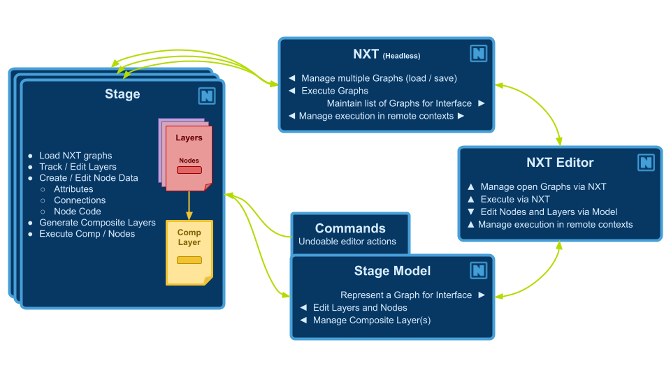

# File Format and Design

## NXT file spec

NXT files follow standard `.json` file specifications with a few specific keys in the root dictionary. 

---TODO: Figure out what these keys are.

## Design Philosophy

Nobody will ever read this pretentious wall of text, but it was an important part of the development process. We hope you find it interesting, and you may find your way here if your start to dig deeper and wonder why things are the way they are.

### Discovery

Nxt provides a visual map/model of user facing attributes that can be understood at a glance, and presents the code in context. This invites the user to extend and modify the functionality. 

Nxt is designed around making processes and code as accessible as possible with low overhead. 

- Artists can modify attributes on code templates and learn to make code changes that would normally require a TD.

- TD’s can establish layered templates for processes and write nodes and graphs.

- Developers can provide Nxt ‘factory nodes’ for using their tools without writing a custom UI.

### Functional/Procedural

Nxt follows a functional model. It eschews object oriented inheritance with a layer model. This allows data to be inspected on the fly and easily read.

#### Why not visual programming?

Nxt differs from a visual programming environment where every function (math, concatenation, data, flow control) is wrapped up in a node. Fully visual programming environments result in sprawling graphs. While the functions are readable, they are not dense. Nxt displays code standard text notation but creates a visualization for the data.

- VP graphs can be tedious to construct. A simple operation can often require a dozen nodes but could be represented in 3 lines of code.

- VP graphs are code under the surface anyway, so to extend the functionality, you need to write code, or construct graphs of graphs.

- VP is a great tool for visualization of your data and flow, readability, experimentation, and discovery.

- NXT is half visual. Half code. Seeks to keep the best parts and remove the friction for more seasoned developers.

#### Why not Houdini?

Houdini is a tool for building tools. It’s a visual processing engine. Can’t it do all of this already?

- Houdini doesn’t do layering

- Houdini is great, but maybe not the best at everything

- Artists have decades of experience in other tools

- Large segments of production already built around need to be built around Maya, Nuke, Unreal

- HDA’s are black boxes and can be slow in host applications

- PDG is great, and expensive.
  
## Application structure

