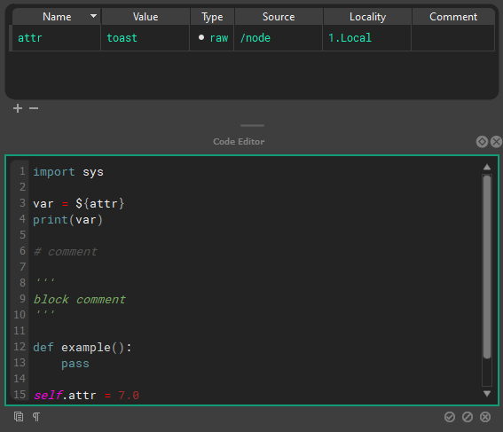
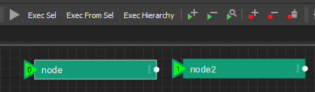
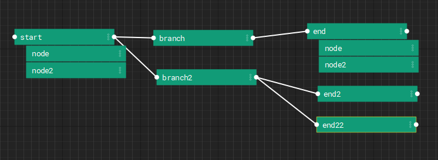
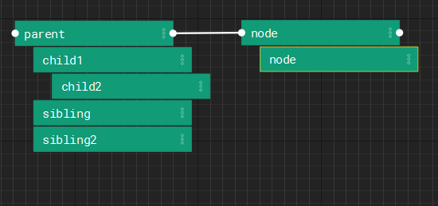

# Graphs and Nodes

A graph is a stage of nodes. Each node holds attributes and a block of code,
and the graph runs the nodes in order. This page covers those parts and how
they fit together. How a graph is built from layers, and how nodes inherit
from their parents and instances, is on
[Layers and References](composition.md).

## Stage

The stage is a collection of graphs, trees, and layers of nxt [nodes ](#node)that set the [composition structure](composition.md) and [execution order](#execution-order) for an nxt file.

!!! note "Stage attributes and composition"
    Note that each layer is also a node, and those nodes get composited to the master STAGE. Each node that is parented to a layer inherits the attributes of the layer/stage. This can be useful for defining global variables, or a state that needs to propogate into the entire graph.

## Node

A node is a container for code (or compute) and a collection of attributes. Every node contains a single [code block](#compute) that is executed when a node is run. [Execution order](#execution-order) is defined both by hierarchy and connections to execution plugs on the nodes.

## Attributes

[Nodes](#node) contain [attributes ](#attributes)that are read from and written to from inside a node’s [code block](#compute). Attributes can also be connected to inputs and outputs of other nodes via [tokens ](#tokens)in  attributes, token paths within the code block, or dragging and dropping attribute connections between nodes.

At editor time (before the graph has begun [executing](#execution-order)) attribute values can be composited into other attribute’s values or into the text of a code block via `${path/to/node.otherattr}_rest_of_attr_value`. 

A node’s local attributes can be resolved by name alone via `${attrname}`

!!! note "Hotkeys"
    The raw/composited state can be visualized by toggling editor resolution on and off using `Q`, `W`, `E`.
    NXT includes a full hot key editor. (Window > [Hotkey ](hotkeys.md)Editor)

!!! example
    The node at `/path/to/node` has the attribute `otherattr` with the value `simple_stupid`, and our local node has an attribute named `myattr` with the value `never_eat`

    | Unresolved                       | Resolved                 |
    | -------------------------------- | ------------------------ |
    | keep_it_${path/to/node.attrname} | keep_it_simple_stupid    |
    | ${myattr}_shredded_wheat         | never_eat_shredded_wheat |

!!! warning "Cached view"
    Cached view should only be used to inspect and debug your data. It should not be considered accurate, _especially_ if you are changing the data via the `self.attribute` paridigm. Any data that NXT is not confident in will be drawn with red hashes.


A node’s local attributes can be changed inside a node’s code block following python convention as seen below.

    self.attr_name = 'example code'
    print(self.attr_name + ' is always boring.')

While executing, the [Stage](#stage) can have arbitrary attributes add/set/retrieved on it, that will be available to all nodes, as seen below. Note: Inside a node’s codeblock the stage is accessed via all caps STAGE

    STAGE.anyattr = 'anything you want'
    print(Stage.anyattr)

!!! note "Attribute connections"
    It is best practice to display inter-node dependencies via hierarchy or connections of attributes, rather than hide that dependency in the code. This will make your layers more portable and friendly to other users. Despite this best practice, other nodes and their attributes can be accessed inside a code `block using STAGE.lookup('path/to/node')` and `STAGE.lookup('path/to/node.otherattr')`.

## Tokens

A token is like a [reference or pointer](workflows.md#transition-map) to another token or value. [OS ](workflows.md#transition-map)style pathing is used to resolve attribute and file tokens.

Attribute token syntax is `${}`: if it can resolve, it substitutes the attribute, if not it will be empty

```
        ${attribute}
        ${/absolute_node_path.attribute}
        ${../relative_nodepath.attribute}
```

File validation syntax `${file::}`: this will always resolve to a real file, and will return an empty string if the file doesn't exist. Used to validate files for reading.

```
        ${file::file.nxt}
        ${file::C:/absolute_path/file.nxt}
        ${file::../relative_path/file.nxt}
```

File path token syntax `${path::}`this will  attempt to resolve to a valid path. If not, it will be empty. Used to expand paths for writing.

File path token syntax `${contents::}` will include the contents of an external file. For example, `${contents::${file::external.py}}` will include the contents of `external.py` in the attribute, compute, _and_ it will resolve tokens written within this file.

!!! note "Relative file resolution"
    The `${file::}` and `${path::}` tokens will resolve relative paths based on the parent folder of the current display layer.

!!! note "Using an external IDE"
    The `${contents::}` token allows the use of an external IDE for authoring your compute blocks.

Tokens are _not_ python template strings, even though they share the syntax.

!!! note "Quote behavior in tokens"
    Since all attribute values are stored and processed as strings in NXT before they are composed as python objects, you have do manually manage string attributes. The value will _substitute as written_. In some cases, it makes sense to have string attributes in quotes, in other cases, it makes sense to add quotes in the code block. 
    For example if you had an attribute `side` set to a value of `L`

    `foot_${side}` and `'foot_' + '${side}'` are equally valid. This really comes down to convention.
    
    There is a simple `w()` convivence function to assist with adding quotes when using a python string object as a string.
    
    ```
    my_attr = 'quotes go away when it becomes a string object'
    self.attribute = w(my_attr)
    ```
    
    `my_attr` can now be used by downstream nodes as a string

## Compute

The compute block/code block  is standard python code, with the exception that it will deep-resolve tokens over 1000 levels deep. (should this be a preference?)



!!! note "Hotkeys"
    The raw/composited state can be visualized by toggling editor resolution on and off using `Q`, `W`, `E`.

    `numreturn` or `ctrl+enter` or clicking off the code will accept your edit
    
    `tab` and `shift+tab` handle multi-line indents
    
    NXT includes a full hot key editor.(Window > [Hotkey ](hotkeys.md)Editor)

## Execution Order

### Stage/Layer Node
_Stub for this feature once new layer editor arrives_

### Execution Root

A stage can have root nodes with no parent node and no node connected to it’s input execution plug. Use execute tags to define the order



### Execution Plugs

Nodes have execution plugs on their left and right to determine execution order. Nodes are executed from left to right along the execution chain specified by these connections.



!!! danger
    We don't have checks for circular dependencies yet. So don't setup loops.

### Hierarchies/Stacks

Nodes have relationships we refer to as “parent”, “child”, and “sibling” to describe their relationship to one another inside the stage to influence composition and execution order. 



To begin execution from a given node, the first node is run, followed by a depth first execution of each of it’s descendants. Following the execution of the descendants, the root node whose input [execution plug](#execution-plugs) is connected to the current node’s output execution plug will be run following the same logic.
