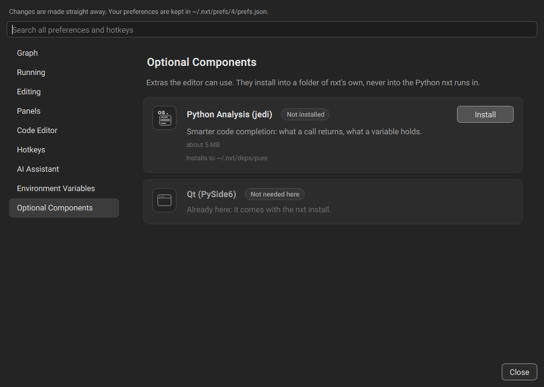

# Optional Components

Some parts of nxt are optional extras, installed when you want them rather
than with nxt itself:

| Component | What it is for | Needed in |
| :-------- | :------------- | :-------- |
| Python Analysis (jedi) | Smarter code completion: what a call returns, what a variable holds. See [Python analysis with jedi](reference.md#python-analysis-with-jedi). | Every host, and standalone. Optional. |
| Qt (PySide6) | The toolkit the editor window is built with. | Blender and Unreal, which ship no Qt. Maya and a standalone install already have it. |

They install into a folder of nxt's own, never into the host's Python, so
they need no admin rights, survive host updates, and can be shared by a
whole studio.

## For artists



Open **Edit > Preferences > Optional Components** in the editor. Each component has
a card saying whether it is installed, and one button for what to do next:

- **Install** downloads it and sets it up. The editor keeps working while it
  does; **Details** shows what is happening, and **Cancel** stops it.
- **Update** appears when the installed version is not one this nxt works
  with.
- **Remove** takes it out again.

jedi is used as soon as it is installed, with no restart. If you pick
**Python Analysis (jedi)** (under **Autocomplete** in the code
editor's right-click menu, or in **Edit > Preferences > Code Editor**)
before installing
it, nxt offers to install it for you.

Qt can't be installed from the editor in Blender or Unreal, because the
editor needs it to open. Use **Install Qt (PySide6)** in the host's nxt menu
the first time, as described in [Installation](install.md#qt-for-blender-and-unreal).
After that the dialog shows it, and offers **Update** when a newer nxt needs
a different version; the update finishes the next time the host starts.

A card can also say:

- **Managed by your studio**: your studio installed it in a shared folder.
  There is nothing to do.
- **Not needed here**: the host already has it, as Maya has Qt.
- **Installed** with no button: it came with your Python install, for
  example from `pip install nxt-editor[completion]`.

When something needs an update, the editor says so once in the status bar
at the bottom of the window, with a link to the dialog.

## Where they go

```
~/nxt/deps/pure            jedi, and anything else that is pure Python
~/nxt/deps/py311           Qt for Python 3.11 hosts
~/nxt/deps/py313           Qt for Python 3.13 hosts
~/nxt/deps/py311-crt14.29  Qt for Blender 4.2 to 4.5 on Windows
```

Pure Python components work in every host, so one copy serves them all. Qt
has compiled code, which only loads in the Python version it was built
for, so it gets a folder per version. Blender 4.2 to 4.5 on Windows ship an
older Microsoft C++ runtime that the newest PySide6 crashes on, so they get
PySide6 6.10 in a folder of their own.

**Open folder** on each card shows where it is.

## For studios

### A shared folder

Set `NXT_DEPS` to a shared folder, and nxt looks there first, on every
machine. Install the components into it once and artists never have to:
their dialog shows them as **Managed by your studio**.

If artists can't write to the folder, anything it is missing installs into
their own `~/nxt/deps` instead, and what the studio provides still wins.
If they can write to it, installing from the dialog fills the shared folder
for everyone.

To fill it, run pip with each host's Python, into the folder names above:

```
<any python>       -m pip install --target <shared>/pure          "jedi>=0.19,<0.21"
<unreal python>    -m pip install --target <shared>/py311         "pyside6-essentials>=6,<6.12"
<blender 5 python> -m pip install --target <shared>/py313         "pyside6-essentials>=6,<6.12"
<blender 4 python> -m pip install --target <shared>/py311-crt14.29 "pyside6-essentials>=6,<6.11"
```

or, with `NXT_DEPS` set, let nxt do it with each host's Python:

```
<host python> <nxt_editor>/integration/optional_deps.py install jedi
<host python> <nxt_editor>/integration/optional_deps.py status
```

### Without internet access

Set `NXT_DEPS_WHEELS` to a folder of wheel files, and every install, from the
dialog or a host's menu, comes from that folder and nothing else. The dialog
says **Installing from ..., offline**. Several folders can be given,
separated by `;` on Windows and `:` elsewhere.

Make the folder on a machine that has internet access with `pip download`:

```
pip download -d <wheels> "jedi>=0.19,<0.21"

pip download -d <wheels> --only-binary=:all: --platform win_amd64 --python-version 3.11 "pyside6-essentials>=6,<6.12"
pip download -d <wheels> --only-binary=:all: --platform win_amd64 --python-version 3.13 "pyside6-essentials>=6,<6.12"
pip download -d <wheels> --only-binary=:all: --platform win_amd64 --python-version 3.11 "pyside6-essentials>=6,<6.11"
```

jedi is pure Python, so one download serves every host and platform. For
PySide6, download one set per platform your hosts run on (`win_amd64`,
`manylinux_2_34_x86_64` or `macosx_13_0_universal2`) and per Python version
they use.

## Environment variables

| Variable | What it does |
| :------- | :----------- |
| `NXT_DEPS` | A folder to look in first, and install to when it can be written to. Default: `~/nxt/deps`. |
| `NXT_QT_DEPS` | The older name for `NXT_DEPS`, from when only Qt was installed this way. Still read when `NXT_DEPS` is not set. |
| `NXT_DEPS_WHEELS` | One or more folders of wheel files. Installs come only from there, with no internet access needed. |
| `NXT_USER_DIR` | nxt's user folder. When set, the default is `$NXT_USER_DIR/deps` rather than `~/nxt/deps`. |
