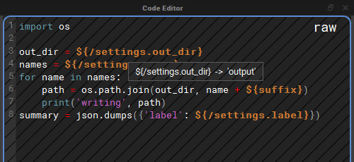

# What's New

This page summarises what is new in recent releases of **nxt_editor**, and
in **nxt_core 0.22**.
Each item links to the part of the docs that explains it in full.

## Unreleased

**New**
- **Three looks to choose from**, in **Options > Preferences... > Look**:
  Modern, Classic (how the editor looked before) and Host application,
  which looks like Maya, Blender or Unreal when the editor runs in them,
  and a **Stylesheet** of your own to lay over it. See
  [The editor's look](reference.md#the-editors-look).
- **The graph has no edge.** Pan, frame and go to nodes as far out as you
  like; the canvas grows as you go.
- **Renaming an attribute renames the tokens that use it**, and
  **parenting a node keeps its instances pointed at it**, both undoable,
  with **Options > Update Tokens on Attr Rename** and **Update Instance
  Paths on Parent** to turn them off. See
  [Renaming an attribute](reference.md#renaming-an-attribute) and
  [Parenting an instanced node](reference.md#parenting-an-instanced-node).
- **Sub-graphs**: **Open Sub-graph** (`Ctrl+Shift+G`) opens the graph a
  sub-graph node runs, and the Property Editor lists that graph's world
  attributes the node does not set yet. See
  [Sub-graph nodes](reference.md#sub-graph-nodes).
- **Options > Preferences...** has every preference you can set, with
  what each does, including ones that had no menu, like drag zoom speed and
  how the graph follows a run. Sections on the left, one page each, and a
  search that looks through all of them. See
  [Preferences](reference.md#preferences).
- **AI Assistant settings** open one provider at a time: each is a section
  whose header says how it is set up, the provider asked first starts open,
  and the list scrolls so everything can be reached on a small screen. See
  [Signing in](reference.md#signing-in).
- The editor's title shows the name of the Maya scene or `.blend` file its
  host has open, `nxt maya [rig_v012.ma]`, so the editors of two sessions
  of the same host can be told apart in the taskbar.

**Fixed**
- The code editor's completion list opens under the line, with its names
  starting where the word being completed starts. It was drawn to the left
  by the width of the line numbers, and over the bottom of the line.
- The mini map leaves out the backdrops of a layer hidden in the graph, as
  it does that layer's nodes.
- Two quick clicks on a Layer Manager toggle count as two: the second was
  taken for a double click and did nothing.
- The Environment Variables dialog shows its Name and List column titles
  whole in an empty table, and a long file path no longer makes it wide.
- Clicking into a node's code and away without typing no longer adds an
  undo step, marks the layer as unsaved, or copies inherited code onto the
  target layer.

## nxt_editor 4.13.0

### The graph

- **New graph from the tabs**: a **+** after the last tab, or a double
  click on the empty bar beside the tabs, makes a new graph. See
  [Tabs](reference.md#tabs).
- **Bookmarks** save a view of the graph under a name, with `Ctrl+B`, and
  `Ctrl+1` to `Ctrl+4` go back to the first four. They are saved with the
  graph. See [Moving around](reference.md#moving-around).
- **Pan with `Space`** and a left drag, for a trackpad or a mouse without a
  middle button, and a graph is **framed when it opens** (**View > Frame
  All on Open**). See [Moving around](reference.md#moving-around).
- **Layout Nodes** (`Shift+L`) lays nodes out by the order they run in. See
  [Laying out nodes](reference.md#laying-out-nodes).
- **Snapping**: a dropped line snaps to the nearest plug that can take it,
  and grid snapping goes to the nearest grid line. See
  [Lines between nodes](reference.md#lines-between-nodes).
- **Push Positions to Target Layer** gives a lower layer the layout you
  see. See
  [Pushing positions to a lower layer](reference.md#pushing-positions-to-a-lower-layer).
- The **world node** can be copied and pasted onto another graph or layer.
  See [Deleting and pasting nodes](reference.md#deleting-and-pasting-nodes).
- **Ignore Breakpoints**, in the Execute menu and on the toolbar, lets runs
  go straight through breakpoints without removing them. While it is on,
  breakpoints are drawn as a red outline in the graph, the Outliner and the
  Build View. See [Running nodes](reference.md#running-nodes).
- When a build fails, the editor **dings and flashes** in the taskbar or
  Dock if it is behind another window. See
  [Running nodes](reference.md#running-nodes).

### Layers and files

- **Layer toggles are icons** with tooltips: display layer, mute, solo,
  lock and the new eye. See [Layer toggles](reference.md#layer-toggles).
- **Hide a layer in the graph** with the eye, or **Hide In Graph** on its
  menu. Its nodes, lines and backdrops leave the graph a node at a time,
  while the layer still composites and runs. See
  [Hiding a layer in the graph](reference.md#hiding-a-layer-in-the-graph).
- Shift click a layer's arrow to open or close every layer under it. See
  [Layer Manager](reference.md#layer-manager).
- **Files changed on disk**: saving over a file something else changed
  asks first, and coming back to the editor offers to reload. See
  [Files changed on disk](reference.md#files-changed-on-disk).
- **References that cannot be found** are listed in a notice with **Edit
  References...**, and a graph saved by a **newer nxt** asks before it
  opens. See [Reference Editor](reference.md#reference-editor).
- **Env files** set environment variables as nxt starts, in the editor, in
  a host and in a headless run, and **Options > Environment Variables...**
  edits them. See [Env files](extensions.md#env-files).
- A file you pick under one of your `NXT_FILE_ROOTS` is stored relative to
  that root, and one in a folder an env file variable names is stored from
  that variable. See
  [How references are found](reference.md#how-references-are-found).
- **Any language**: graphs, logs and every other file nxt reads or writes
  are UTF-8, so names, comments and code can be in any language on any
  system. See [NXT file spec](reference.md#nxt-file-spec).

### Outliner, Build View and Property Editor

- **Drag rows in the Outliner** to parent their nodes. See
  [Outliner](reference.md#outliner).
- In the **Build View**, a selected node's name stays readable when its
  breakpoint is set. See [Build View](reference.md#build-view).
- The Property Editor can **filter attributes**, **copy and paste
  attributes** between nodes, **complete node paths and tokens** as you
  type, and shows where **running changed an attribute's type**. The
  **Position** fields move every selected node. See
  [Filtering attributes](reference.md#filtering-attributes),
  [Copying and pasting attributes](reference.md#copying-and-pasting-attributes),
  [Completing paths and tokens](reference.md#completing-paths-and-tokens),
  [Types changed by running](reference.md#types-changed-by-running) and
  [Position](reference.md#position).
- Typing in the Property Editor's or Hotkey Editor's table jumps to the
  row starting with what you typed. See [Hotkeys](hotkeys.md).

### Code Editor and completion

- **Fold** indented blocks from the gutter or with `Ctrl+Shift+[` and
  `Ctrl+Shift+]`. See [Folding](reference.md#folding).
- **Drop files** into the code to write a `${contents::}` token for them.
  See [Dropping files](reference.md#dropping-files).
- **Completion keeps up with typing**, offers a node's inherited and
  instanced attributes after `self.`, and after a build completes
  `STAGE.` and `self.` on what the build left there. See
  [Completion](reference.md#completion) and
  [STAGE and self after a build](reference.md#stage-and-self-after-a-build).
- **Optional Components** (**Options > Optional Components**) installs Qt
  and jedi in any host, with no restart. See
  [Optional Components](optional_components.md).
- A `#` inside a string is no longer coloured as a comment, the Code Editor
  keeps its scroll when the same node is shown again, and the Output Log
  keeps following new text, with a **Wrap Lines** option. See
  [Highlighting](reference.md#highlighting) and
  [Property Editor, History View, Output Log and Workflow Tools](reference.md#property-editor-history-view-output-log-and-workflow-tools).

### Hosts

- `NXT_NO_MENU=1` leaves nxt's own menu out of Maya, Blender and Unreal.
  See [Leaving the nxt menu out](install.md#leaving-the-nxt-menu-out).
- The Maya module ships jedi, so Python Analysis works from the zip.

### Fixes and speed

- **Save** saves the graph you are looking at, not a layer right clicked
  earlier.
- A big value stored by a build no longer stalls the editor afterwards,
  and during a build only the nodes whose state changes are redrawn.
- **Shift expanding a big hierarchy**, in the graph or the Outliner, draws
  it in one pass and shows nodes as they are drawn, rather than freezing
  the editor.

### nxt_core 0.22.0

- Graphs and the files they read are **UTF-8**, so they open in any
  language on any system. Older files that are not UTF-8 still open.
- An **instance path that loops** back to the node or its ancestors is
  logged and ignored rather than hanging the comp, and an exec chain that
  loops is stopped. See [Instancing](reference.md#instancing).
- Running a node no longer copies the world node's attributes for every
  node, so a big value on the world node no longer slows every node after
  it.
- `${/node._code}` gives a node's code as text. See
  [Tokens](reference.md#tokens).
- Loading a file warns about a **node path written twice**. See
  [NXT file spec](reference.md#nxt-file-spec).
- A node's enabled state shows straight away, without a recomp.
- For tools: `rename_node_attr(refactor=True)` updates the tokens that use
  a renamed attribute, `retarget_instance_paths` keeps instance paths on
  nodes that were parented elsewhere, env files are read as nxt starts, and
  a file saved by a newer nxt raises `NewerFileError` unless it is opened
  inside `nxt_io.allow_newer_files()`.

## nxt_editor 4.12.0

**New**
- **Align and distribute** nodes and the points on their lines: Align
  Left, Center, Right, Top, Middle and Bottom, and Distribute
  Horizontally and Vertically, from **Align** in the right click menu, a
  new Align button on the toolbar, or `Shift+W`/`A`/`S`/`D` and
  `Alt+Shift+W`/`S`/`A`/`D`. See
  [Aligning nodes and points](reference.md#aligning-nodes-and-points).
- **Points turn with the line**: a curved line runs smoothly through each
  point in the direction it is going, instead of looping back round it.
  See [Lines between nodes](reference.md#lines-between-nodes).
- **Select All** has an icon on the toolbar, and its tooltip shows its
  shortcut.

**Fixes**
- Docked panel tabs no longer shift over and cut their names short when
  hovered; only their outline changes color.

## nxt_editor 4.11.0

**New**
- The Instance View marks the node it is drawn from with a target at the end
  of its name, the same target as on **Follow Selection**. It moves to
  whichever node you show, from the graph, the Outliner, **Show Selected** or
  a double click in the view.

## nxt_editor 4.10.1

**Fixed**
- Only proxy nodes are striped again, as before 4.10.0: nodes made by an
  instance that have nothing of their own yet. An instance, or a node that
  overrides anything its instance gives it, looks like any other node, in the
  graph and the Outliner.

## nxt_editor 4.10.0

**New**
- **Instance View.** **Window > Instance View** shows a node's instance
  connections and nothing else: what it instances from, back to the first
  source, and every node that instances it. Nodes are grey cards with their
  layer colors along the top. **Follow Selection** shows whichever node you
  select, **Show Selected** shows it on demand, and **Sync Selection**
  selects and frames the nodes you pick in it in the graph and the Outliner.
- **Find nodes by name.** The Outliner's search and **Find Node** (`/`) work
  like the filters in mix: `*` for anything, commas between names, and a `/`
  to match the whole path. Find Node opens empty, lists the nodes it finds,
  and Enter selects and frames all of them. Searches run once you stop
  typing, or on Enter.
- **Any layer color, shown your way.** **Change Color** picks from the full
  spectrum, and the layer keeps exactly the color you pick. **View > Options
  > Layer Color View** sets how colors are shown to you: as they are (the
  default), darker where too light for the white names on them, or every
  hue at one lightness and chroma that you set. It is saved as your
  preference and never changes anyone's colors.
- **Instanced nodes are striped** in the graph and the Outliner.
- **Run buttons with icons.** Execute Selected, Execute From Selected and
  Execute Hierarchy have their own icons and tooltips on the toolbar.
- Shift click a build group's arrow in the Outliner, or Shift double click
  its heading, to collapse or expand every node in it.

**Fixed**
- The Property Editor could crash the editor with **Neutral Property Text**
  turned on.

## nxt_editor 4.9.0

**New**
- **Colors white text reads on.** Layer and backdrop colors are kept dark
  enough for their white names to read. **Change Color** has a new picker
  that only offers those colors: the layer palette, a field of hues, and a
  shade bar that stops before a color gets too light. Brighter colors
  saved in older graphs show as the nearest readable color, keeping their
  hue.
- **The Outliner works like the graph.** The node hotkeys work in it
  (**D**, **N**, **Del**, **S**, **B**, **X** and so on), double click or
  the arrow collapses a node, Shift does everything below it, and Ctrl
  double click or **F2** renames it in its row. Start, skip and break
  points show on their rows, and right clicking below the rows adds or
  pastes a node. Rows are larger, and hovering or selecting one outlines
  it, as in the graph.
- **The Build View outlines too.** The selected node has an amber edge and
  the one under the mouse a white edge, and the node that runs next stays
  red.
- **Neutral Property Text.** Turn on **View > Options > Neutral Property
  Text** to show the Property Editor's attributes in text that reads on
  any layer color: bright and bold for a value set on the node,
  and a softer grey for one it inherits. Each row's header is filled with
  its layer's color, and stays in view as you scroll. Off by default.
- **Faster on big graphs.** Opening a large graph takes about half as long,
  mostly from building the Workflow Tools faster. Moving and panning are
  smoother, toggling a break or skip point is immediate, and a hidden graph
  or Outliner does no work until it is shown again.

**Changed**
- Node names are always white, on every layer color.
- The layer chips on a node are wider and sit side by side.

**Fixed**
- Break and skip points work on a graph that has not been saved yet.
- Collapsing a node in the Outliner and the graph always agree. Selecting a
  node inside a collapsed one no longer opens its row, which made the next
  click expand it instead.
- A node collapsed by a lower layer expands on the first click.
- Renaming a node opens the box over the node rather than above it.
- The checkboxes in the list of layers to save on close always show.

## nxt_editor 4.8.0

**New**
- **A new look.** Neutral dark greys, so the only color on screen is your
  layers'. Nodes are rounded cards in their layer's color with a soft
  shadow and a clearer font, and a selected node has an amber outline.
  Panels, menus, tabs and the toolbar are restyled to match. Text is the
  same size on every platform and in every host.
- **Outliner.** **Window > Outliner** lists the graph's nodes as a tree,
  grouped by the start point whose build runs them, with a section for
  the nodes in no build. Rows are colored like their nodes, with a chip
  for each other layer the node is on. A search box finds a node at any
  depth by typing its name (regular expressions work too), and a right
  click gives the same menu as the node in the graph.
- **Hide the graph.** **Window > Stage View** hides the node graph to give
  the space to the docks, and shows it again. The editor remembers your
  choice.
- **Curved lines.** **View > Curved Connections** draws the lines between
  nodes as curves. It is saved with the graph, and remembered as your
  preference for graphs that have not saved a choice.
- **Points on lines.** Double click a line to add a point, then drag it to
  route the line around other nodes. Points can be box selected, stay
  visible at any zoom, and are saved with the layer.
- **Break a connection.** Right click a line, a point on it, or a plug and
  pick **Break Connection**. The exec input or attribute is left empty
  rather than keeping the connected value.

**Fixed**
- Making a layer under a new, unsaved layer no longer fails to draw the
  graph with `'NoneType' object has no attribute '_source_layer'`.
- Layers show their colors again in the list of layers to save on close.

## nxt_editor 4.6.1

**New**
- **Backdrops.** Press **C**, or pick **Add Backdrop** in the graph's right
  click menu, to put a colored box behind a group of nodes. With nodes
  selected it fits around them. Drag its header to move it and everything
  inside it, or Ctrl+drag to move just the backdrop. Double click the header
  to give it a title, a note in its top left corner, and a color. Backdrops
  can sit inside each other, show on the mini map, and are saved with the
  layer.
- **Sign in with Codex.** The AI Assistant can use your ChatGPT account
  through Codex, the same way it uses Claude Code. Install Codex, then press
  **Sign in with Codex** in **Options > AI Assistant**.
- **More than one ChatGPT account.** Each account and workspace keeps its
  own sign in. **Switch Account** lists the ones used before, plus
  **Another Account or Workspace...**

**Fixed**
- **Sign in with ChatGPT finishes.** It could fail with `invalid_grant`, or
  turn away an account in an organization's workspace as "only available to
  members of its workspace". Errors now say what went wrong and what to do.
- **API keys save on Linux without a keyring.** With no system keyring,
  keys and sign ins are kept in `~/nxt/ai_sign_ins.json`, readable only by
  you.
- **Child nodes move with their parent** again when it is dragged.
- **Closing the editor no longer crashes** on the way out.

**Notes**
- Carries nxt_core 0.21.2.

## nxt_editor 4.5.3

**New**
- **AI Assistant.** A panel to chat with Claude, OpenAI, Grok or a local
  model about the open graph. Turn it on in **Options > AI Assistant**, then
  open it from **Window > AI Assistant**. It looks over, searches, changes
  and runs the graph, and lists each step it takes. All of its changes in
  one reply are one undo. Chats are kept, to go back to, pin or delete. It
  can read code on your computer (it asks first outside the graph's folder),
  look into the modules a graph imports without running them, and remember
  notes. Nothing is sent anywhere until you ask it something.
- **Show a layer's file.** Right click a layer and pick **Show in Explorer**
  (Windows), **Reveal in Finder** (Mac) or **Show in File Manager** (Linux).

**Fixed**
- **The editor looks the same in Maya as it does on its own.** The workflow
  buttons, tabs and panels lost their styling in a host.
- **Every change to a layer shows on it as it happens.** Taking something
  off a node now marks the layer as changed straight away.
- **Stop puts the build back.** Stopping no longer empties the build list or
  looks like it is still running, and in Maya the next node no longer runs
  after Stop.
- **Saving a layer no longer fails on a damaged editor cache** ("Ran out of
  input").
- **Turning a node on or off shows straight away**, without a recomp.

**Notes**
- Carries nxt_core 0.21.2.

## nxt_editor 4.4.3

**New**
- **Code completion knows your graph.** While typing in the code editor you
  get node attributes, `${}` tokens and the modules a compute can import.
  With jedi installed it also knows what a call returns.
- **Reference Editor.** See and change the layers a graph references, in one
  place.
- **Hover a `${}` token to see its value, Ctrl+click it to go to its node.**
- **Brackets and quotes close themselves** in the code editor.
- **Double click a dock tab to float it.** **View > Reset Layout** puts every
  dock back where it started.
- **Save As into a new tab writes a copy** and leaves the original open and
  unchanged.
- **The Code Editor Data State Overlay is under View > Options**, and the
  editor remembers whether it is on.

**Fixed**
- **Maya's own windows keep their fonts.** Opening the editor no longer
  changes the font of Maya's windows, such as the node editor's tab search.
- **References keep working after Save As to another folder.** A reference
  relative to the graph is rewritten so it still points at the same file.

**Notes**
- Carries nxt_core 0.21.1.

## nxt_editor 4.4.1

- **Maya's fonts are left alone again.** Opening the editor in Maya no
  longer changes the font of Maya's own windows, such as the node editor's
  tab search.
- **Code Editor Data State Overlay** is now under **View > Options**, and
  the editor remembers whether you turned it on or off.

## Editor

### A code editor that works like a code editor

The code editor picked up the tools you would expect from a text editor. All
of them only apply while the code editor has focus, and all of them can be
rebound in the [Hotkey Editor](hotkeys.md#code-editor).

- **Find and replace** (`Ctrl+F` / `Ctrl+H`) floats over the top right of the
  code, with a match count, next and previous (`F3` / `Shift+F3`) and toggles
  for match case, whole word and regular expressions.
- **Go to line** (`Ctrl+G`) previews the line as you type, and `Esc` puts the
  cursor back where it was.
- **Line editing**: duplicate (`Ctrl+Shift+D`), move (`Alt+Up` / `Alt+Down`)
  and delete (`Ctrl+Shift+K`) lines, and expand the selection from word to
  line to everything (`Ctrl+D`).
- **Highlighting** of every use of the word under the cursor, and of the
  bracket next to the cursor and its partner.
- **Completion** (`Ctrl+Space`) offers python builtins, names from the modules
  the compute imports, the node's attributes and `${}` tokens, and words
  already in the compute. Each source can be switched on or off under
  **Options > Autocomplete**, along with suggestions while you type.
- **Auto-pairing**: typing `(`, `[`, `{`, `"` or `'` adds the closing
  character, typing a closer that is already there steps over it, and
  typing an opener with text selected wraps the selection.
- **Syntax highlighting** colours every match on a line. Before, a line
  with two tokens or two strings only had the first one coloured.

See [Code Editor](reference.md#code-editor).

### Tokens you can hover and follow

In Raw View (`Q`), hover a `${}` token in the code editor to see what it
resolves to, and `Ctrl+click` a token that reads another node's attribute to
select and frame that node in the graph. See
[Following tokens](reference.md#following-tokens).

### Completion that knows what a compute can use

- What the world node imports completes in every node, because every
  compute can use it.
- The names nxt gives every compute complete without an import: `STAGE`,
  `self`, `w`, `execute`, `nxt_path`, `ExitNode`, `ExitGraph` and `types`.
- Inside `${/` the node paths in the graph complete, and after a node path's
  dot its attributes, each as a whole token.
- **Host Modules**, a new source: in Maya, `cmds`, `om`, `pm` and the other
  usual short names complete before any import line is written, and so do
  `unreal` in Unreal and `bpy` in Blender. Only modules the host has
  already loaded are offered, so nothing is imported to complete them.
- **Python Analysis (jedi)**, a new optional source: with
  `pip install nxt-editor[completion]`, completion after a dot knows what a
  call returns or a variable holds.

See [Completion](reference.md#completion).

### Docks

- Double click a dock's tab, where docks are tabbed together, to float it.
  Drag a floating dock back in, or double click its title bar to dock it
  again.
- **View > Reset Layout** puts every dock back where a fresh install has it.

See [Docks and layout](reference.md#docks-and-layout).

### Editing layer references

Right click a layer in the Layer Manager and choose **Edit References...** to
add, remove, retype and reorder what that layer references, without opening
the file in a text editor. Paths can be typed exactly as you want them
stored (for example with an environment variable in them), or picked with a
file browser. A **resolved** toggle shows where each reference lands on this
machine, and references that cannot be found are kept and marked rather than
dropped. See [Reference Editor](reference.md#reference-editor).

### Reload Source

Somebody else saved a file your graph is built on? **Reload Source...** (on a
layer's right click menu and in the **File** menu) re-reads that layer, and
as many of the layers it references as you choose, from disk, and
composites the graph again. It can be undone. See
[Reload Source](reference.md#reload-source).

### Mini map

A mini map in the bottom right of the graph shows the whole graph and where
the view is inside it. Click or drag in it to move the view. Toggle it with
**View > Toggle Mini Map** or `Ctrl+M`. See [Stage](reference.md#stage-view).

### Build view

- A **find** button next to the play button scrolls the build to the node
  selected in the graph, and tells you when the selected node is not part of
  the build.
- The build stays current as the graph changes: disabling, deleting,
  renaming, re-parenting or reconnecting a node updates it straight away.

See [Build View](reference.md#build-view).

### Smaller changes

- Deleting a node no longer leaves a "ghost" of it in the graph and the
  build view.
- Pasting several nodes is a single undo.
- Nodes no longer animate open by default, which makes opening a node with
  many children noticeably faster. The **Animate Nodes** action turns the
  animation back on (see [Stage](reference.md#stage-view)).
- A graph is only composited and drawn when its tab is first selected, so
  opening many files at once is faster.
- Renaming a node no longer rebuilds the whole graph when it does not need
  to, and a renamed node keeps its position.
- When a build is set up, a cached runtime that no longer matches the graph
  is rebuilt automatically instead of stopping the build part way through.
- An uncaught error from nxt only opens a dialog when an editor window is
  visible. In batch or headless sessions it is printed instead, so a host
  running a graph in the background never stops on a dialog nobody can see.
- The editor no longer needs `pyside6-rcc` (or any other compiled step) to
  build its icons and styles, so the same release works on every platform
  and host.

## Host integrations

- **Maya**: Maya 2025, 2026 and 2027 are supported. The `nxt_ui` command
  takes `-path` to open graphs, `-close` and `-reload`, and reuses the editor
  that is already open. Graphs can be run in Maya standalone from the
  command line with `run_maya_graph.py`, including a start node and
  parameters, and the builtin `_maya_standalone_graph` node now passes its
  `_start_node` on. See [Maya](install.md#maya).
- **Unreal**: a plugin for Unreal 5.4 to 5.8 that carries its own copy of nxt,
  nxt_editor and Qt.py, with an **nxt** menu and a one click
  **Install Qt (PySide6)**. See [Unreal](install.md#unreal).
- **Blender**: an add-on for Blender 4.2 and newer with an **NXT** menu:
  Open Editor, Close Editor, Run Graph, Run Last Graph, Reload Code and
  Install Qt. See [Blender](install.md#blender).
- Hosts that do not ship Qt install PySide6 once into `~/nxt/deps`, or into a
  shared folder named by `NXT_QT_DEPS`. See
  [Qt for Blender and Unreal](install.md#qt-for-blender-and-unreal).

## Python versions

| Package | Python |
| :------ | :----- |
| nxt-core | 3.7 to 3.14 |
| nxt-editor | 3.9 to 3.14 (PySide6 6.x, below 6.12) |

PySide6 is held below 6.12 until the editor has been tested on it.

## Core (nxt_core 0.21)

- **Faster compositing and execution.** Large graphs composite and build
  substantially faster, with identical results.
- **One order for finding a reference, everywhere.** A reference written
  as an absolute path is used as it is. Any other reference is looked for
  under the folders in `NXT_FILE_ROOTS` first, and then relative to the
  layer that holds it, never relative to wherever the editor was started.
  A file under a root therefore wins over a file of the same name beside
  the layer, which is what lets a working copy listed in `NXT_FILE_ROOTS`
  stand in for the published one. Adding a reference in the editor now
  finds the same file that opening the graph does. See
  [How references are found](reference.md#how-references-are-found).
- **References that cannot be resolved are kept.** Previously a reference to
  a file that could not be found was dropped from the layer, and saving the
  layer wrote it out without the reference. Now it is kept exactly as
  written, so a graph opened on a machine that cannot see a share no longer
  loses its references when saved.
- **Reloading layers from disk** (`Stage.reload_layers`), which is what
  [Reload Source](reference.md#reload-source) is built on. A reference added,
  removed or reordered in the file since the graph was opened is picked up.
- **Removing a layer removes everything it brought in**, including all of its
  references, and only the reference that pointed at it.
- **Targeted renames**: renaming a node that nothing else composites against
  updates it in place instead of recompositing the stage.
- Graph parameters can enable or disable nodes for a run, for example
  `{"/node._enabled": false}`. See
  [Running a graph in Maya standalone](install.md#running-a-graph-in-maya-standalone).
